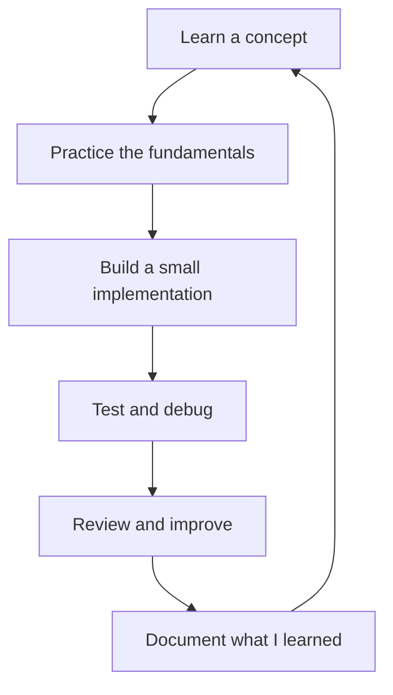

# Harsh Sharma Gaur

  <strong>Computer Science & Engineering Student</strong> 
  Lovely Professional University · India

  
  

---

## About

I’m a Computer Science & Engineering student at Lovely Professional University, interested in software development, technology, and continuous learning. I’m focused on strengthening my programming fundamentals, improving problem-solving skills, and learning how to build reliable software.

- 🎓 **Education:** Computer Science & Engineering — Lovely Professional University
- 🌱 **Currently focused on:** Programming fundamentals and software development
- 🤝 **Open to:** Learning opportunities and meaningful collaboration
- 📍 **Based in:** India

## GitHub Analytics

  
  

  

  

> These cards are generated from GitHub activity and may take a little time to load or refresh. Language statistics reflect code available in public repositories.

## Contribution Snake

The contribution animation below is generated automatically by the GitHub Actions workflow in this repository.

  <picture>
    <source media="(prefers-color-scheme: dark)" srcset="https://raw.githubusercontent.com/sharmaharsh7921-source/sharmaharsh7921-source/output/github-contribution-grid-snake-dark.svg"/>
    <source media="(prefers-color-scheme: light)" srcset="https://raw.githubusercontent.com/sharmaharsh7921-source/sharmaharsh7921-source/output/github-contribution-grid-snake.svg"/>
    
  </picture>

## Learning Workflow

My general approach to learning and building software:

## Current Goals

- Build strong programming and computer science fundamentals.
- Practice structured problem-solving.
- Learn development tools and collaborative workflows.
- Turn new concepts into practical, well-documented work.

## Connect

  

---

<em>Learning consistently. Building thoughtfully. Improving every day.</em>

